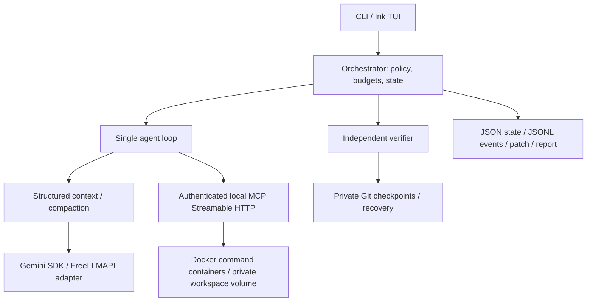

# MiniCoder

MiniCoder V1 is a terminal-native autonomous coding agent for local Git repositories. One agent plans, navigates source, applies patches, runs commands in Docker, and requests independent runtime verification. Every run exports a patch and structured trace. The source repository is never mounted into the sandbox or changed by a run.

```bash
agent run /path/to/repo "Fix the pagination boundary bug"
```

## Architecture



The model selects one schema-validated action per turn. The runtime controls execution and success. See [architecture](docs/architecture.md) for boundaries, invariants, and tradeoffs.

## Installation

Requirements: Bun 1.3.11 or newer, Git, and a running local Docker daemon. Host ripgrep is not required; it is installed in the sandbox image. On Linux, your account needs Docker access. The image includes Bun, Node/npm, Python, a C/C++ toolchain, Git, and ripgrep.

From this repository:

```bash
bun install --frozen-lockfile
bun run sandbox:build
export PATH="$PWD/bin:$PATH"
agent --help
```

The PATH step exposes this checkout's executable. It also makes the intended executable explicit if another product already provides a command called `agent`. Optional global package linking: `bun link`; ensure Bun's global bin directory precedes other `agent` binaries. Rebuild the image after changing sandbox/tool code or dependencies. The image contains installed packages from this checkout, including compatible pinned tree-sitter WASM grammars.

## Strict $0 inference setup

MiniCoder has no paid-provider integrations, automatic model routing, or monetary budget. It never upgrades a provider account. **Using these model IDs alone cannot guarantee a $0 bill.** Use a Gemini project with billing disabled and a FreeLLMAPI endpoint/account with no paid overages. Confirm that externally before setting the required attestation:

```env
GEMINI_API_KEY=<your free-tier key>
GEMINI_MODEL=gemini-3.8-flash
FREELLMAPI_BASE_URL=<your free-only OpenAI-compatible endpoint, including /v1 if required>
FREELLMAPI_API_KEY=<your endpoint key>
FREELLMAPI_QWEN_MODEL=qwen3.7-flash
FREELLMAPI_DEEPSEEK_MODEL=deepseek-v4-flash-0731
MINICODER_FREE_ONLY=true
MINICODER_FREE_TIER_CONFIRMED=true
```

Export these variables in your shell or fill an ignored local `.env`; [`.env.example`](.env.example) contains placeholders. No real credentials are distributed. Remote FreeLLMAPI URLs require HTTPS; plain HTTP is accepted only for loopback development endpoints. The sample `localhost:3001/v1` is a placeholder, not a server included with MiniCoder. Both fallback models use the same generic adapter and explicit model IDs.

Default chain:

```text
Gemini gemini-3.8-flash
  -> FreeLLMAPI qwen3.7-flash
  -> FreeLLMAPI deepseek-v4-flash-0731
  -> MODEL_UNAVAILABLE
```

Each transient availability failure gets two retries with exponential backoff. A provider's `Retry-After` delay is honored up to 60 seconds per retry, within the run's wall-clock budget; cancellation interrupts the wait. Quota/rate limits, HTTP 408/429/5xx, model unavailability (404), and retryable connection failures can advance the chain. Authentication/configuration errors do not switch providers. An invalid coding action or a failed test never causes fallback. Missing provider credentials mark that provider unavailable. Once fallback occurs, later turns stay on the selected provider.

Any `--model` selection pins that model and disables fallback, including `--model gemini`. `--benchmark` also disables fallback. SDK-internal retries are disabled so retries remain controlled and observable.

## Usage and configuration

```bash
agent run /path/to/repo "Fix the off-by-one error" --non-interactive
agent run /path/to/repo "Add input validation" --model gemini --benchmark
agent run /path/to/repo "Refactor the parser" --max-turns 50 --timeout 900
agent run /path/to/repo "Fix the build" --network enabled
```

`--timeout` is the total run budget in seconds. Autonomous networking defaults to `--network none`. `--non-interactive` prints a single JSON result to stdout; traces contain the detailed actions. Exit codes: 0 success, 1 other failure, 130 cancellation. Ctrl-C/SIGTERM abort active work, export partial work when possible, persist a terminal state, and clean up containers/volumes. SIGKILL or daemon failure may require manual resource cleanup.

Repository setup and verification are read from `.minicoder.json` **before** the agent starts:

```json
{
  "bootstrap": ["bun install --frozen-lockfile"],
  "verification": ["bun test", "bun run typecheck", "bun run lint"]
}
```

Only configure commands that actually exist in that repository. Bootstrap runs in a separate network-enabled container phase by default, without host credentials. Installed workspace dependencies persist in the volume; `/tmp` and processes do not persist between commands. Set `MINICODER_BOOTSTRAP_NETWORK=false` to disable setup networking too. No dependency installer is guessed automatically. Every command, including setup and verification, stays in Docker.

Without explicit verification, MiniCoder conservatively selects existing package scripts (`test`, `build`, `lint`, `typecheck`), `cargo test --locked`, `go test ./...`, or pytest only when pytest configuration is present in `pyproject.toml`. Watch scripts and obvious placeholder tests are excluded. Java/Gradle and ambiguous Python projects require explicit commands. Go/Rust/Java/pnpm/yarn and project-specific utilities must be installed in a derived sandbox image as needed; their runtimes are not bundled. Runs with no meaningful verification commands cannot succeed.

Environment overrides:

| Variable | Default | Purpose |
| --- | --- | --- |
| `MINICODER_MAX_TURNS` | `50` | Agent turn limit |
| `MINICODER_TIMEOUT_MS` | `900000` | Wall-clock limit |
| `MINICODER_COMMAND_TIMEOUT_MS` | `60000` | Per-command limit |
| `MINICODER_MODEL_TIMEOUT_MS` | `120000` | Per-provider request timeout |
| `MINICODER_MAX_TOKENS` | `2000000` | Aggregate model token limit |
| `MINICODER_SANDBOX_IMAGE` | `minicoder-sandbox:v1` | Local image containing the worker |
| `GEMINI_CONTEXT_LIMIT` | `1048576` | Gemini context ceiling |
| `QWEN_CONTEXT_LIMIT` | `262144` | Qwen context ceiling |
| `DEEPSEEK_CONTEXT_LIMIT` | `1048576` | DeepSeek context ceiling |

Context ceilings are configurable deployment limits; confirm them against your endpoint's supported model limits. CLI limits override environment limits. `--artifact-dir` selects an output root outside the source repository.

## Agent loop and tools

```text
PLAN -> ACT -> OBSERVE -> UPDATE PLAN/STATE -> RECOVER IF NEEDED -> repeat
                                      request_completion -> runtime verifier
```

Plans are complete atomic arrays of `{id, content, status, notes?}` with unique IDs and at most one in-progress item. A plan is required before editing or shell execution; all items must be done before requesting completion. These checks never authorize success.

| MCP tool | Behavior |
| --- | --- |
| `list_tree` | Bounded file tree; honors Git ignores and common generated directories |
| `read_file` | Bounded line ranges, line numbers, binary/large-file rejection |
| `ripgrep` | Actual ripgrep search with bounded results |
| `tree_sitter_symbols` | Structural names/ranges for JS/TS/TSX, Python, Go, Rust |
| `edit_file` | Single-file unified patch; canonical path checks and Git validation |
| `run_shell` | Docker-only command, cwd, timeout, bounded streams, exit code, cleanup |
| `git` | Status, diff, log, show; no remote operations |
| `update_plan` | Validated full-plan replacement |
| `request_completion` | Requests runtime verification; cannot declare success |

MCP is a per-run loopback Streamable HTTP endpoint with a random bearer capability and origin rejection. It is not a general-purpose public MCP server. Each tool result is capped at 16,000 model-visible characters (roughly 4k tokens), retaining useful beginning/end portions and an omission notice. Raw redacted results are stored separately. Shell streams have a further 1 MB cap per stream; patch export has a 12 MB cap and fails rather than silently exporting a partial patch.

## Independent verification and recovery

The runtime verifies the input baseline, freezes the command list, and independently reruns checks after completion requests. It audits workspace policy before/after tests and validates the Git patch. A failure returns command exits, diagnostics, and policy errors to the same agent while budgets remain. Only a verifier pass permits `SUCCESS`.

Private Git objects provide operational checkpoints before edits, commands, and plan transitions. A passing baseline/final verification creates a validated checkpoint. After a regression from a validated state, two repair cycles are allowed; a third failed completion verification restores that checkpoint and re-verifies it. Normal intermediate shell failures do not trigger rollback. If the input baseline already fails, no validated rollback target is invented.

Checkpoints exist only in a separate runtime volume, which is never attached to autonomous command containers. Internal commits never enter the source repository's public history. Dependencies/generated artifacts are excluded from snapshots; recovery preserves ignored dependencies, so checks after restore can still detect dependency-related failures.

## Context, hooks, traces

Context contains the runtime contract, user task, plan/notes, inspected/modified files, Git state, latest verification, recovery evidence, compacted discoveries/commands/errors, and recent bounded results. It uses no embeddings, vectors, or semantic RAG. At 75% of the selected context budget, older actions compact into a structured summary. At 90%, further compaction is required or the run stops. Fallback-enabled runs use the smallest configured context ceiling to keep the next provider usable. Raw trace events remain on disk. Context usage is a conservative character estimate; provider token metadata is used when available, with estimates otherwise.

Real sequential hooks: `PreToolUse`, `PostToolUse`, `SessionStart`, `SessionEnd`, `UserPromptSubmit`, `Notification`, `Stop`, `PreCompact`. The runtime uses them for policy, accounting, persistence, notifications, and compaction. Embedders can register handlers through `Hooks`; V1 intentionally has no arbitrary shell-hook configuration.

Default artifacts live under `~/.local/state/minicoder/.agent/runs/<run-id>/`:

```text
manifest.json       immutable run inputs and limits
state.json          latest atomic state snapshot
events.jsonl       observable actions, failures, timings (JSONL)
outputs/            redacted tool / verifier output
patches/            attempted edit patches
final.patch         complete diff, including partial work on failure
report.json         outcome, model, turns, tokens, calls, recovery, verification
```

API keys, bearer credentials, and recognizable key patterns are redacted from traces; credentials are rejected from exported edits/patches. Hidden/private chain-of-thought is never requested or recorded. Artifact redaction is not a universal secret detector: keep secrets out of source/tasks and review output before sharing. Persistent diagnostics and a partial patch support manual interruption recovery; there is no `resume` command in V1. Live Docker checkpoint objects are deleted during normal cleanup.

## Testing

No API keys are required for these commands:

```bash
bun run typecheck
bun run lint
bun test
MINICODER_DOCKER_TESTS=1 bun test tests/docker.test.ts
bun run smoke
bun run check:secrets
```

The smoke test builds a temporary Git fixture, uses a deterministic action source, and exercises the real Docker, MCP, tools, autonomous loop, verifier, checkpoints, patch export, and host-preservation checks. It is an infrastructure test, not a model-quality benchmark. It prints the retained artifact directory.

Opt-in live tests require confirmed free-only credentials:

```bash
MINICODER_FREE_TIER_CONFIRMED=true bun scripts/live-smoke.ts gemini
MINICODER_FREE_TIER_CONFIRMED=true bun scripts/live-smoke.ts qwen
MINICODER_FREE_TIER_CONFIRMED=true bun scripts/live-smoke.ts deepseek
MINICODER_FREE_TIER_CONFIRMED=true bun scripts/live-smoke.ts fallback
```

The fallback test deliberately omits the Gemini credential for that test process, then follows the configured Qwen/DeepSeek availability chain. Pinned tests never switch models. These tests keep diagnostics and check that fixture source stays unchanged.

The configured FreeLLMAPI endpoint advertises `qwen3.7-flash` and `deepseek-v4-flash-0731` as its model IDs. The display-style identifier `deepseek/deepseek-v4-flash-0731free` returned HTTP 404 there. Use the advertised ID, or override `FREELLMAPI_DEEPSEEK_MODEL` if your endpoint requires a different exact ID.

For endpoints with a low request rate, allow a longer live fixture budget: `MINICODER_TIMEOUT_MS=900000 MINICODER_FREE_TIER_CONFIRMED=true bun scripts/live-smoke.ts qwen`. The script defaults to five minutes when no timeout environment override is supplied. A FreeLLMAPI access key does not configure upstream providers: a "No candidate model has a configured, usable provider key" error requires the appropriate provider key in your endpoint's dashboard.

## Security model and V1 status

Autonomous commands use fresh non-root containers: 2 CPUs, 1 GB RAM, 128 PIDs, read-only image, writable private workspace, 256 MB temporary filesystem, dropped capabilities, and no-new-privileges. There are no host mounts, Docker socket, host credentials, or model API keys inside them. Runtime-controlled Git/copy containers briefly use root with only DAC/ownership capabilities and access to the checkpoint volume. Containers are removed after each command, including timeouts, so background processes cannot survive into the next action. The original Git directory is not copied; `git log/show` expose the isolated input baseline, not full upstream history.

**Docker is a local isolation boundary, not perfect security. MiniCoder is not production-secure.** Kernel/daemon vulnerabilities, malicious dependencies, excessive disk use, and network exfiltration when explicitly enabled remain risks. CPU/RAM/PID/time limits are enforced, but Docker volumes have no V1 disk quota. Known secret/config paths and generated directories are excluded from source copying; source symlinks/submodules and special files are rejected. Some projects therefore need a prepared ordinary-file checkout or a derived image.

V1 implements the complete local workflow and passes deterministic/unit, protocol, Docker recovery, and end-to-end fixture checks. Live Gemini and Qwen produced valid coding actions, but their coding fixtures did not complete: Gemini encountered HTTP 503 and Qwen exhausted HTTP 429 retries. The refreshed DeepSeek route returned HTTP 503 indicating a missing usable upstream provider key. An unavailable provider is reported honestly, never treated as a successful run. See [validation notes](docs/validation.md) for the exact observed outcomes. There are no performance or benchmark claims.

Verification proves configured checks and runtime policy, not semantic correctness of every natural-language task. Tests remain editable source; a task-specific trusted acceptance command is strongly preferable. Command blocking is defense in depth and not a shell parser or security boundary. Ordinary Docker copy limits and artifact caps bound some I/O but do not replace filesystem quotas.

Future direction: durable crash reconstruction and resume, followed by stronger trusted acceptance checks and a small reproducible evaluation harness. V2 is not implemented.
